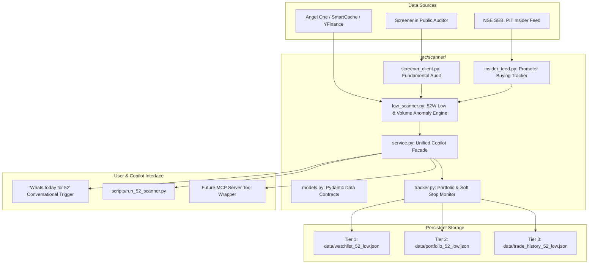

# Master Implementation Plan: 52-Week Low Capitulation Strategy & Scanner System

> **Repository File**: `docs/PLAN_52_WEEK_LOW_STRATEGY.md`  
> **Status**: **Phase A Complete ✅ | Ready for Phase B ⏳**  
> **Current Test Suite**: 73/73 tests passing (`.venv/bin/pytest tests/`)  
> **Master Context Registry**: [`docs/PROJECT_STATUS.md`](file:///Users/aswinkarthik.th/.gemini/antigravity-ide/scratch/quant-copilot/docs/PROJECT_STATUS.md)  
> **Living Strategy Spec**: [`docs/STRATEGY_52_WEEK_LOW.md`](file:///Users/aswinkarthik.th/.gemini/antigravity-ide/scratch/quant-copilot/docs/STRATEGY_52_WEEK_LOW.md)

---

## 1. Goal Description
Implement an institutional-grade **52-Week Low Capitulation Strategy and Scanner Engine** within `quant-copilot`. The strategy identifies fundamentally resilient, low-debt Indian companies experiencing panic selling absorbed by smart money (high volume anomaly at 52-week lows).

It supports the user's complete interactive lifecycle:
1. **Discovery (Radar)**: Copilot presents fundamentally audited 52W low capitulation candidates.
2. **Watchlist Shortlist**: The user reviews candidates, asks questions, and adds selected stocks to an active **Watchlist** to wait for buy confirmation.
3. **Buy Trigger Indication**: During daily checkins, the copilot alerts the user when a watched stock prints a **Stage 2 Buy Confirmation**.
4. **Bought Portfolio Tracking**: When the user buys a stock and informs the copilot, it registers the position into the **Active Portfolio**.
5. **Daily Health & Exit Sentinel**: On daily checkin, the copilot monitors all bought stocks against their **Soft Stop-Loss** (Capitulation Low) and **Profit Targets** (**Target 1 at 20 EMA**, **Target 2 at 50 EMA**).
6. **Permanent Trade Ledger & Archive**: When all shares of a stock are sold, it is removed from active monitoring and preserved in a permanent audit log with full execution metrics.

---

## 2. Core Architecture: The 3-Tier Storage Model

---

## 3. Four Phased Implementation Slices

### Phase A: Architecture, Data Contracts & Fundamental / Insider Engines (✅ COMPLETE)
- [`src/scanner/__init__.py`](file:///Users/aswinkarthik.th/.gemini/antigravity-ide/scratch/quant-copilot/src/scanner/__init__.py): Public exports.
- [`src/scanner/models.py`](file:///Users/aswinkarthik.th/.gemini/antigravity-ide/scratch/quant-copilot/src/scanner/models.py): Pydantic contracts (`FundamentalAudit`, `InsiderTradeRecord`, `CapitulationSignal`, `WatchlistStock`, `PortfolioStock`, `TradeSellRecord`, `ClosedTradeLedger`, `DailyDashboard52`).
- [`src/scanner/screener_client.py`](file:///Users/aswinkarthik.th/.gemini/antigravity-ide/scratch/quant-copilot/src/scanner/screener_client.py): Screener.in parser enforcing 5 Golden Rules (0% pledge, D/E < 0.6, Int Coverage > 3.5, CFO > 0, ROCE >= 12%).
- [`src/scanner/insider_feed.py`](file:///Users/aswinkarthik.th/.gemini/antigravity-ide/scratch/quant-copilot/src/scanner/insider_feed.py): NSE SEBI PIT parser filtering material promoter open-market purchases ($\ge$ ₹1 Cr).
- Tests: [`tests/test_screener_client.py`](file:///Users/aswinkarthik.th/.gemini/antigravity-ide/scratch/quant-copilot/tests/test_screener_client.py) & [`tests/test_insider_feed.py`](file:///Users/aswinkarthik.th/.gemini/antigravity-ide/scratch/quant-copilot/tests/test_insider_feed.py) (7/7 tests passing; 73/73 total project suite passing).

---

### Phase B: Technical Engine & Two-Stage State Machine (⏳ NEXT UP)
- **File**: `src/scanner/low_scanner.py`
- **Responsibilities**:
  1. Integrates with `SmartCacheManager` and `AngelOneProvider` / `YFinanceProvider` to scan universe of stocks (e.g. Nifty 500 or selected basket).
  2. **Stage 1 (Radar Detection)**:
     - Daily Low $\le$ 52-Week Low (within 0.5% tolerance).
     - Volume Anomaly: $\text{Volume}_{\text{today}} \ge 3\times$ to $10\times \text{SMA}_{20}(\text{Volume})$.
     - Automatically calls `ScreenerClient.audit_company(symbol)`.
     - Automatically calls `InsiderFeed.get_symbol_insider_activity(symbol)`.
     - Calculates Automated Levels:
       - **Support SL**: Capitulation Candle Low.
       - **Target 1**: 20-Day EMA.
       - **Target 2**: 50-Day EMA.
  3. **Stage 2 (Confirmation Trigger)**:
     - Checks T+1 / T+2 price action: did price hold above the capitulation low? Did price close above the capitulation candle's high or above the 5-day EMA?
     - Scans active stocks in user's **Watchlist** to generate actionable `BUY_TRIGGER` alerts.
- **Tests**: `tests/test_52_low_scanner.py` (synthesize test OHLCV data with known volume anomalies, verify level calculations, verify Stage 1 $\to$ Stage 2 state transitions).

---

### Phase C: Watchlist, Portfolio Tracker, Soft Stop & Target Sentinel (⏳ Pending)
- **Files**: `src/scanner/tracker.py`, `src/scanner/service.py`
- **Responsibilities**:
  1. Manage 3 persistent JSON files:
     - `data/watchlist_52_low.json`: Watched stocks.
     - `data/portfolio_52_low.json`: Active holdings.
     - `data/trade_history_52_low.json`: Closed trade ledger.
  2. Implement partial scaling out: record partial sells at Target 1 (50%) and Target 2 or SL.
  3. Auto-archive to `trade_history_52_low.json` when `remaining_quantity == 0`.
  4. Daily soft stop sentinel checks:
     - 🟢 **SAFE**: Price $> +3.0\%$ above Capitulation Low.
     - 🟡 **RADAR ALERT**: Price within $1.5\%$ of Capitulation Low.
     - 🔴 **DECISION REQD**: Price closed below Capitulation Low at 3:30 PM.
     - 🎯 **TARGET 1 HIT**: Price $\ge$ 20 EMA.
     - 🏆 **TARGET 2 HIT**: Price $\ge$ 50 EMA.
- **Tests**: `tests/test_scanner_service.py` & `tests/test_tracker.py`.

---

### Phase D: Conversational Trigger ('Whats today for 52') & CLI Runner (⏳ Pending)
- **Files**: `scripts/run_52_scanner.py`, MCP wrapper.
- **Responsibilities**:
  1. CLI runner to execute scans or view active portfolio status.
  2. Conversational trigger: when user types `"Whats today for 52"`, produces the structured daily dashboard briefing:
     - 🎯 **New 52-Week Low Capitulations (Radar candidates for today)**
     - 🟢 **Watchlist Buy Triggers (Stocks you are watching that triggered BUY today!)**
     - 🛡️ **Bought Portfolio Sentinel (Status of bought stocks: Safe / Alert / Target 1 / Target 2)**
     - 🏢 **Promoter / Insider Buying Alerts**
  3. Follow-up Q&A capability for individual stocks.
  4. Updates to `docs/STRATEGY_52_WEEK_LOW.md` and `docs/PROJECT_STATUS.md`.

---

## 4. Verification & Quality Gates
- **Automated Tests**: `.venv/bin/pytest tests/` (must stay 100% green).
- **Zero Lookahead Bias**: Technical indicators computed strictly on EOD close or shift(1) intraday.
- **Cross-Platform**: Full Windows/Mac compatibility using `pathlib.Path` and UTF-8 encoding.
