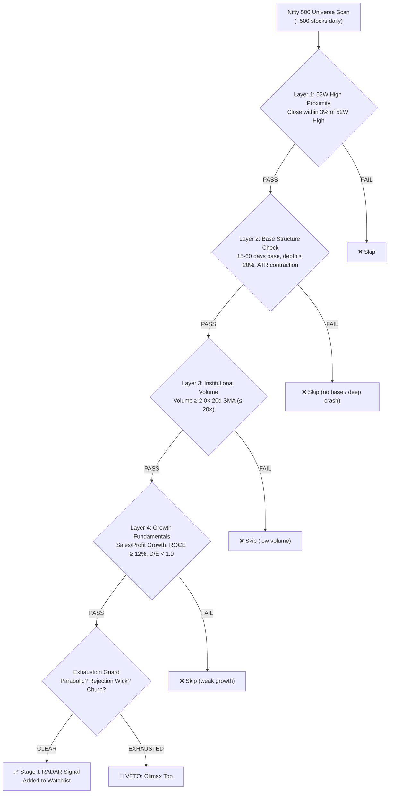
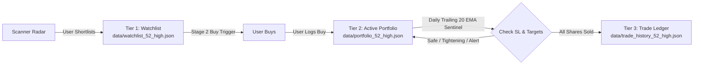

# 52-Week High Breakout Strategy (Institutional Breakout Accumulation - IBA)

> **Status**: Production-Ready — **All Phases (A, B, C, D) Complete** (122/122 total project tests passing)  
> **Target Market**: Indian Equities (NSE/BSE)  
> **Strategy Type**: Institutional Momentum Continuation & Stage 2 Trend Riding  
> **Authoring Lead**: QuantCopilot AI  
> **Master Roadmap**: [PROJECT_STATUS.md](file:///Users/aswinkarthik.th/.gemini/antigravity-ide/scratch/quant-copilot/docs/PROJECT_STATUS.md)  
> **Analysis Reference**: [52_WEEK_HIGH_STRATEGY_ANALYSIS.md](file:///Users/aswinkarthik.th/.gemini/antigravity/brain/07406fe0-1f7a-4051-ae6c-e101bd3fab0a/52_WEEK_HIGH_STRATEGY_ANALYSIS.md)

---

## 1. Strategy Thesis & Academic Foundation

The 52-week high effect is one of the most robust and persistent market anomalies in quantitative finance:

* **George & Hwang (2004, *Journal of Finance*)**: Proximity to the 52-week high predicts future stock returns significantly better than past returns. Stocks near their 52-week highs earn systematic alpha (+0.45%/month) over stocks near their lows.
* **Psychological Anchoring**: Retail traders anchor to the round-number 52W high and believe the stock is "too expensive" to buy, causing an **underreaction** to new highs. Institutions use structural breakouts from consolidation bases to accumulate large positions, driving a multi-month trend.

Rather than running a risky short strategy on tops, this strategy deploys **Institutional Breakout Accumulation (IBA)**:
1. **Long-Only Breakout Execution**: Buy confirmed breakouts emerging from sound, tight consolidation bases.
2. **Exhaustion Guard as a Negative Filter**: Vetoes buying into distribution tops (parabolic runs, rejection wicks).

---

## 2. The 4-Layer Qualification Funnel

### Layer 1: 52-Week High Proximity
* Price close must be within **3%** of rolling 252-day high, or today's high broke prior 52W high, or fresh 52W high printed in the last 5 trading days.
* Scans entire curated **Nifty 500/200 universe** locally (`config/nifty500.csv`), preventing omission of steady compounders.

### Layer 2: Base Structure & VCP Check
* **Base Duration**: 15 to 60 trading days consolidation.
* **Base Depth**: Maximum correction inside base $\le 20\%$.
* **ATR Contraction (VCP)**: Pre-breakout ATR $\le 80\%$ of peak base ATR (volatility dried up).
* **Stan Weinstein Stage 2**: Price > 150-day SMA, Price > 200-day SMA, and 200-day SMA is rising.

### Layer 3: Institutional Volume Expansion
* Breakout day volume $\ge 2.0\times$ 20-day SMA volume (or 5-day max ratio $\ge 2.5\times$).
* Upper ceiling $\le 20.0\times$ to avoid single-day blowoff exhausts.

### Negative Filter: Exhaustion Climax Guard
If **any 2 or more** triggers fire, the breakout is rejected:
1. **Parabolic Stretch**: Price $> 40\%$ above 50-day EMA.
2. **Rejection Upper Wick**: Upper shadow $\ge 50\%$ of daily candle range.
3. **Weak Close**: Close in bottom 40% of daily candle range.
4. **Extreme Volume Churn**: Volume $> 15\times$ 20d SMA with $< 1\%$ price gain.

### Layer 4: Growth Fundamental Screen
Enforced via Screener.in (`src/scanner/screener_client.py`):
* **Revenue Growth YoY**: $\ge 10.0\%$
* **Net Profit Growth YoY**: $\ge 12.0\%$
* **ROCE**: $\ge 12.0\%$
* **Debt to Equity**: $< 1.0$ (growth companies can support moderate leverage)
* **Promoter Holding**: $\ge 40.0\%$
* **Promoter Pledge**: $< 15.0\%$

---

## 3. The 3-Tier Storage & Execution Lifecycle

1. **Tier 1 (`data/watchlist_52_high.json`)**:
   - Monitored daily for follow-through Stage 2 Buy Confirmation (close above breakout pivot high).
2. **Tier 2 (`data/portfolio_52_high.json`)**:
   - Monitored daily with dynamic **trailing 20-day EMA ratchet** (moves only UP, never down).
3. **Tier 3 (`data/trade_history_52_high.json`)**:
   - Permanent closed trade ledger with complete execution metrics, realized PnL, duration, and return %.

---

## 4. Daily Sentinel & Trailing Stop Mechanics

| Status Badge | Condition | Action / Notification |
| :--- | :--- | :--- |
| 🟢 **SAFE** | Price > Trailing 20 EMA and > entry price | Hold comfortably; trend riding in progress. |
| 🟡 **TIGHTENING** | Price within 2.0% of Trailing 20 EMA | *"Price approaching trailing stop; monitoring closely."* |
| 🟠 **RADAR ALERT** | 1 close below Trailing 20 EMA | *"First close below 20 EMA. Prepare exit order for tomorrow."* |
| 🔴 **DECISION REQD** | 2 consecutive closes below 20 EMA OR price < initial SL | *"Trailing stop confirmed broken. Recommend full exit."* |
| 🎯 **TARGET 1 HIT** | Price $\ge +15\%$ from entry price | *Recommend booking 50% profit; ratchet SL to Breakeven.* |
| 🏆 **TARGET 2 HIT** | Price $\ge +30\%$ from entry price | *Recommend booking remaining 50% or trailing with 50 EMA.* |

---

## 5. CLI Interface (`scripts/run_52_high_scanner.py`)

| Command | Description | Example |
| :--- | :--- | :--- |
| `daily` | Run full daily evening briefing | `python scripts/run_52_high_scanner.py daily` |
| `radar` | Scan candidate symbols without modifying state | `python scripts/run_52_high_scanner.py radar --symbols TRENT BEL` |
| `portfolio` | Fast portfolio check with trailing stop levels | `python scripts/run_52_high_scanner.py portfolio` |
| `watchlist` | Check watchlist stocks for Stage 2 Buy confirmations | `python scripts/run_52_high_scanner.py watchlist` |
| `audit` | Deep technical, base, and fundamental audit of single stock | `python scripts/run_52_high_scanner.py audit TRENT` |
| `buy` | Log order execution into Tier 2 Active Portfolio | `python scripts/run_52_high_scanner.py buy TRENT 50 7200.0` |
| `sell` | Log partial or full exit (auto-archives to Tier 3 on full exit) | `python scripts/run_52_high_scanner.py sell TRENT 25 8280.0 TARGET_1` |
