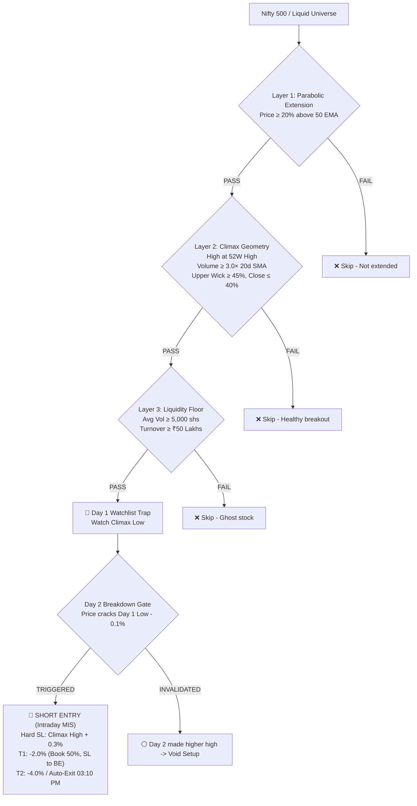

# 52-Week High Institutional Exhaustion Short Strategy (Phase 1: Intraday MIS)

> **Status**: Production-Ready — **Phase 1 Complete** (139/139 tests passing)  
> **Target Market**: Indian Equities (NSE Cash / MIS Segment)  
> **Strategy Type**: Wyckoff Upthrust After Distribution (UTAD) / Buying Climax Reversal  
> **Execution Vehicle**: Cash Equities Intraday MIS (Exit before 03:10 PM IST; 0% Overnight Risk)  
> **Master Roadmap**: [PROJECT_STATUS.md](file:///Users/aswinkarthik.th/.gemini/antigravity-ide/scratch/quant-copilot/docs/PROJECT_STATUS.md)  
> **Implementation Plan**: [plan_52_week_high_exhaustion_short.md](file:///Users/aswinkarthik.th/.gemini/antigravity/brain/6f74293a-12e3-4a1c-a5b9-990a0d70dca2/plan_52_week_high_exhaustion_short.md)

---

## 1. Strategy Thesis & Wyckoff Mechanics

When a stock that has undergone an extended parabolic advance touches a fresh 52-week high on **abnormal volume ($\ge 3.0\times$ 20-day SMA)**, retail traders rush in on fear of missing out (FOMO).

Institutions (FIIs/DIIs/Hedge Funds) exploit this wave of retail buy orders as an **exit liquidity window** to dump massive blocks of inventory without tanking the price during the morning session. By the close, supply completely overwhelms demand:
* The daily candle forms a giant **upper rejection shadow ($\ge 45\%$)** (e.g. Shooting Star / Gravestone Doji).
* The candle closes near its low for the day (bottom 40% of range).

Every single retail breakout buyer who bought near the 52W high is now trapped at an immediate loss. On **Day 2**, the moment price breaks below the **Day 1 Climax Low**, trapped buyers panic-sell their positions, triggering an aggressive **downward momentum waterfall**.

---

## 2. Why Cash Intraday MIS on Day 2? (Phase 1 Architecture)

In the Indian market, single-stock options (outside the top 10 mega-caps) suffer from extreme bid-ask spreads, low open interest, and theta decay. Moreover, holding short futures overnight exposes retail capital to gap-up wipeout risk.

**Intraday MIS solves all three problems:**
1. **Zero Overnight Gap Risk**: All trades exit before 03:10 PM IST. You sleep 100% in cash.
2. **Infinite Option Liquidity Bypass**: You execute directly on the cash equity book (instant millisecond fills).
3. **Small Capital Footprint**: 5x intraday MIS leverage allows testing with just ₹10,000 to ₹50,000.

---

## 3. The 4-Layer Quantitative Funnel

---

## 4. Multi-Table Conversational UX (QuantCopilot Integration)

QuantCopilot automatically separates and organizes all active strategies without requiring specific prompts:

1. **`"Whats today for 52"`**:
   * **Section A**: 52-Week High Breakout (LONG)
   * **Section B**: 52-Week Low Capitulation (LONG)
   * **Section C**: 52-Week High Exhaustion Short (Intraday MIS)
   * **Section D**: Material Promoter Buying (SEBI PIT)

2. **`"52 watchlist"`**:
   * Automatically renders **3 separate tables**:
     * 📉 52-Week Low Watchlist (Stage 2 Rebounds)
     * 🚀 52-Week High Watchlist (Breakout Continuations)
     * 🔻 52-Week High Short Watchlist (Day 2 Panic Breakdown Triggers)

3. **`"52 portfolio"`**:
   * Automatically segregates:
     * 🟢 Positional Delivery Holdings (LONG)
     * 🔴 Active Intraday MIS Positions (SHORT — Exit before 03:10 PM)

---

## 5. Storage Architecture

* `data/watchlist_52_short.json` (Tier 1: Stocks with confirmed Day 1 Climax traps awaiting Day 2 breakdown).
* `data/trade_history_52_short.json` (Tier 3: Permanent audit ledger of realized Intraday MIS trades with net PnL, duration, and exit reasons).

