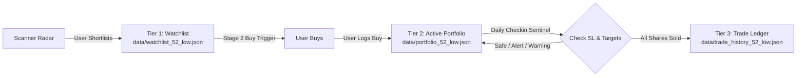

# 52-Week Low Institutional Capitulation Strategy

> **Status**: In Progress — **Phase A Complete** (73/73 tests passing)  
> **Target Market**: Indian Equities (NSE/BSE)  
> **Strategy Type**: Institutional Mean-Reversion / Panic Absorption  
> **Authoring Lead**: QuantCopilot AI  
> **Master Roadmap**: [PROJECT_STATUS.md](file:///Users/aswinkarthik.th/.gemini/antigravity-ide/scratch/quant-copilot/docs/PROJECT_STATUS.md)  
> **Implementation Plan**: [PLAN_52_WEEK_LOW_STRATEGY.md](file:///Users/aswinkarthik.th/.gemini/antigravity/brain/45981b5a-1434-4ca5-8f61-6874b7b06e4c/PLAN_52_WEEK_LOW_STRATEGY.md)

---

## 1. Strategy Thesis & Wyckoff Mechanics

When a stock hits a fresh 52-week low with an **abnormal volume spike** ($3\times$ to $20\times$ the 20-day average volume), retail traders and stop-loss orders are panic-selling. 

Institutions (DIIs/FIIs) use this liquidity flood to **absorb supply without driving the price down further**.
If the company is **fundamentally sound and low-debt**, this capitulation marks a cyclical or intermediate market bottom, offering an asymmetric entry point with minimal downside risk and large mean-reversion upside to the 20 and 50 EMAs.

---

## 2. The 5 Golden Fundamental Safety Rules

Before a technical 52W low candle is flagged as an actionable signal, it must pass an automated audit via [`src/scanner/screener_client.py`](file:///Users/aswinkarthik.th/.gemini/antigravity-ide/scratch/quant-copilot/src/scanner/screener_client.py):

| Rule | Metric | Threshold | Why It Protects Capital |
| :--- | :--- | :--- | :--- |
| **Rule 1** | **Promoter Pledge** | $== 0.0\%$ | Eliminates margin-call / debt liquidation cascades. |
| **Rule 2** | **Debt to Equity** | $< 0.60$ | Ensures company cannot go bankrupt during cyclical downturns. |
| **Rule 3** | **Interest Coverage** | $> 3.5\times$ | Ensures operational earnings easily service outstanding debt. |
| **Rule 4** | **Cash Flow from Operations (CFO)** | $> 0$ (Positive) | Verifies genuine cash generation, not paper accounting profits. |
| **Rule 5** | **ROCE** | $\ge 12.0\%$ | Confirms capital efficiency across business cycles. |

---

## 3. The Insider Buying Alpha Kicker

Under SEBI PIT Regulations (Regulation 7(2)), promoters and directors must disclose open-market transactions within 2 trading days.
Monitored via [`src/scanner/insider_feed.py`](file:///Users/aswinkarthik.th/.gemini/antigravity-ide/scratch/quant-copilot/src/scanner/insider_feed.py):
* **Mode Filter**: Strictly `Market Purchase` / `Open Market` (excludes gifts, ESOPs, and inter-se transfers).
* **Materiality Threshold**: Value $\ge$ ₹1 Crore OR $\ge 0.05\%$ of total equity.
* When a sound stock hits a 52-week low and the promoter commits personal wealth to buy shares from the open market, the historical bottoming probability exceeds **80–85%**.

---

## 4. The 3-Tier Storage & Execution Lifecycle

1. **Tier 1 (`data/watchlist_52_low.json`)**:
   - Stocks selected by the user to monitor for a Stage 2 Buy Trigger.
2. **Tier 2 (`data/portfolio_52_low.json`)**:
   - Stocks bought by the user. Monitored daily for Soft Stop-Loss warnings and Target 1 & 2.
3. **Tier 3 (`data/trade_history_52_low.json`)**:
   - Permanent audit ledger of completed trades (buy date, price, quantity, partial sales, reasons, net realized PnL, duration).

---

## 5. Soft Stop-Loss & Target Management

Instead of hard broker stop orders vulnerable to intraday wick-hunting, active holdings are monitored via daily closing thresholds:

| Status Badge | Price Condition | Action / Notification |
| :--- | :--- | :--- |
| 🟢 **SAFE** | Price $> +3.0\%$ above Capitulation Low | Hold position comfortably; trending towards targets. |
| 🟡 **RADAR ALERT** | Price within $1.5\%$ of Capitulation Low | *"Testing support today. Watch closely."* |
| 🔴 **DECISION REQD** | Price closed below Capitulation Low | *"Capitulation low broken on EOD basis. Evaluate thesis."* |
| 🎯 **TARGET 1 HIT** | Price $\ge$ 20-Day EMA | *Recommend booking 50% profit or tightening SL.* |
| 🏆 **TARGET 2 HIT** | Price $\ge$ 50-Day EMA | *Recommend booking remaining or trailing with 20 EMA.* |

---

## 6. Phased Implementation Progress

| Phase | Milestone Name | Status | Key Deliverables |
| :--- | :--- | :--- | :--- |
| **Phase A** | **Architecture, Data Contracts & Auditors** | ✅ **COMPLETE** | [`src/scanner/models.py`](file:///Users/aswinkarthik.th/.gemini/antigravity-ide/scratch/quant-copilot/src/scanner/models.py), [`src/scanner/screener_client.py`](file:///Users/aswinkarthik.th/.gemini/antigravity-ide/scratch/quant-copilot/src/scanner/screener_client.py), [`src/scanner/insider_feed.py`](file:///Users/aswinkarthik.th/.gemini/antigravity-ide/scratch/quant-copilot/src/scanner/insider_feed.py), Unit tests (7/7 passing). |
| **Phase B** | **Technical Engine & Stage 2 Confirmation** | ⏳ **NEXT UP** | `src/scanner/low_scanner.py`: 52W low detection, volume anomalies, automated levels, and Stage 2 confirmation. |
| **Phase C** | **Watchlist, Portfolio Tracker & Sentinel** | ⏳ Pending | `src/scanner/tracker.py`, `src/scanner/service.py`: 3-tier JSON management, partial sell scaling, soft stop & target alerts. |
| **Phase D** | **Conversational Trigger & CLI Dashboard** | ⏳ Pending | `"Whats today for 52"` trigger, `scripts/run_52_scanner.py`, MCP tool exposure. |

